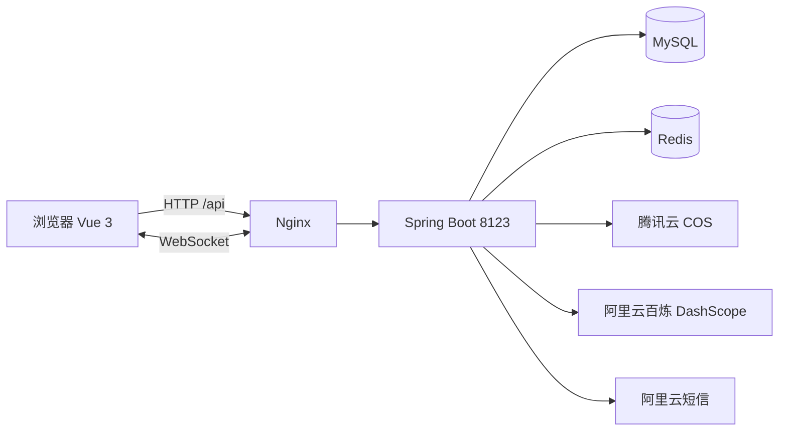
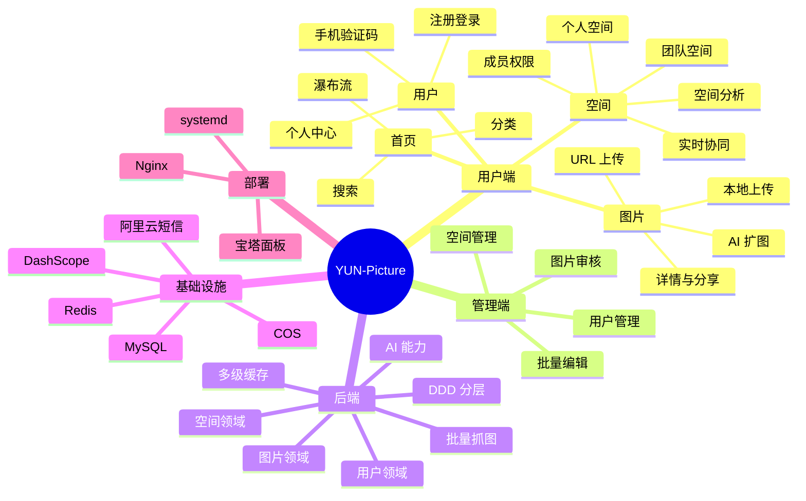

# YUN-Picture · 浮光图记

> 一个基于 Spring Boot + Vue 3 的图片分享与团队协作平台：图片上传、批量采集、空间协作、AI 扩图、AI 看图命名，该有的都有。


**在线体验：** http://123.207.58.189

---

## 📖 项目简介

YUN-Picture（中文名「浮光图记」）是一个前后端分离的图片社区项目。用户可以上传、浏览、搜索图片，按分类和标签整理自己的图库；也可以创建个人空间或团队空间，邀请成员一起管理图片，并通过 WebSocket 实时看到其他成员的编辑操作。

项目同时接入了阿里云百炼的视觉能力：

- **AI 扩图**：用通义万相 `wanx2.1-imageedit` 对图片做 AI 扩图
- **AI 重命名**：用 `Qwen3-VL` 看图自动生成图片名称和标签，能认出动漫/游戏角色或明星时直接用人名，名称不超过 5 个字

后端采用 DDD 分层架构，把「接口层 / 应用层 / 领域层 / 基础设施层」拆开，便于阅读和二次开发。

## ✨ 功能特性

### 🖼 图片

- [x] 本地文件上传、URL 上传，自动压缩、生成缩略图
- [x] 首页瀑布流、滚动加载、图片懒加载
- [x] 关键词搜索、分类浏览
- [x] 图片详情、生成分享链接
- [x] 批量抓图（360 图片搜索，Redis 游标 + seen 集合去重，每次抓到的图不重复）
- [x] AI 扩图（通义万相 `wanx2.1-imageedit`）
- [x] AI 看图重命名 / 打标签（`Qwen3-VL`，名称 ≤ 5 字，认出角色或明星时用名字）

### 👥 空间

- [x] 个人空间 / 团队空间
- [x] 成员邀请与角色权限（浏览者 / 编辑者 / 管理员）
- [x] 空间图片管理、批量编辑分类与标签
- [x] 实时协同编辑（WebSocket + Disruptor，多端同步修改）
- [x] 空间分析（分类占比、标签词云、图片大小等）

### 🔐 用户与管理

- [x] 账号密码注册登录、手机验证码登录
- [x] 个人中心、资料修改
- [x] 管理员：图片审核、用户管理、空间管理

### ⚙️ 工程能力

- [x] Redis + Caffeine 多级缓存
- [x] Spring Session 分布式会话
- [x] Knife4j 接口文档 + OpenAPI 前端代码生成
- [x] DDD 分层架构

## 🛠 技术栈

| 分类 | 技术 |
| --- | --- |
| 后端 | Java 11、Spring Boot 2.7.6、MyBatis-Plus 3.5、Sa-Token、Spring Session、WebSocket + Disruptor、Hutool |
| 数据库 / 缓存 | MySQL 8、Redis、Caffeine |
| 对象存储 | 腾讯云 COS（上传、压缩、缩略图、防盗链） |
| AI 能力 | 阿里云百炼 DashScope：Qwen3-VL（看图命名）、wanx2.1-imageedit（AI 扩图） |
| 短信 | 阿里云号码认证服务（支持本地 mock） |
| 前端 | Vue 3.5、TypeScript、Vite 6、Ant Design Vue 4、Pinia、Vue Router、Axios、ECharts |
| 部署 | Nginx、systemd / 宝塔面板、腾讯云轻量应用服务器 |

## 🏗 系统架构



后端 DDD 分层：

```text
interfaces        接口层：Controller、DTO、VO、Assembler
      ↓
application       应用层：应用服务、一次性任务（补图 / AI 重命名）
      ↓
domain            领域层：实体、领域服务、仓储接口（不依赖具体实现）
      ↑
infrastructure    基础设施层：MyBatis-Plus 仓储实现、COS、短信、AI API、配置、AOP
shared            公共能力：鉴权、WebSocket 协同
```

## 📁 项目结构

```text
YUN-Picture/
├── yun-picture-backend-DDD/         # 后端（DDD 分层）
│   ├── src/main/java/com/songcan/yupicture/
│   │   ├── interfaces/              # Controller / DTO / VO
│   │   ├── application/             # 应用服务、维护任务
│   │   ├── domain/                  # picture / space / user 领域
│   │   ├── infrastructure/          # 持久化、外部 API、配置
│   │   └── shared/                  # 鉴权、WebSocket
│   ├── src/main/resources/          # application.yml 等配置
│   └── sql/create_table.sql         # 建表脚本
├── yun-picture-frontend/            # 前端（Vue 3 + Vite）
│   ├── src/pages/                   # 页面
│   ├── src/components/              # 组件
│   ├── src/api/                     # OpenAPI 生成的接口
│   └── openapi.config.js            # 接口代码生成配置
└── config/                          # 部署脚本、Nginx、systemd 配置
```

## 🚀 快速开始

### 环境要求

- JDK 11+
- Maven 3.8+
- Node.js 20+
- MySQL 8+
- Redis 6+

### 1. 初始化数据库

```bash
mysql -uroot -p < yun-picture-backend-DDD/sql/create_table.sql
```

脚本会自动创建 `yu_picture` 库和所有表。

### 2. 配置后端

在 `yun-picture-backend-DDD/src/main/resources/` 下新建 `application-local.yml`（不要提交到仓库）：

```yaml
cos:
  client:
    host: https://your-bucket.cos.ap-shanghai.myqcloud.com
    secretId: your-secret-id
    secretKey: your-secret-key
    region: ap-shanghai
    bucket: your-bucket-1250000000

aliYunAi:
  apiKey: sk-your-dashscope-key
  vlModel: qwen3-vl-plus

aliyun:
  sms:
    accessKeyId: your-access-key-id
    accessKeySecret: your-access-key-secret
    signName: your-sign-name
    templateCode: "100001"
    # 本地联调打开 mock：不调用阿里云，验证码直接打印在日志里
    mock: true
```

如果本地 MySQL 账号密码不是 `root / 123456`，在 `application-local.yml` 里覆盖即可：

```yaml
spring:
  datasource:
    url: jdbc:mysql://localhost:3306/yu_picture?useSSL=false&allowPublicKeyRetrieval=true&serverTimezone=Asia/Shanghai
    username: your-user
    password: your-password
  redis:
    host: 127.0.0.1
    port: 6379
```

### 3. 启动后端

```bash
cd yun-picture-backend-DDD
mvn -DskipTests clean package
java -jar target/yu-picture-backend-DDD-0.0.1-SNAPSHOT.jar --spring.profiles.active=local
```

启动后接口地址为 `http://localhost:8123/api`，Knife4j 文档为 `http://localhost:8123/api/doc.html`。

### 4. 启动前端

```bash
cd yun-picture-frontend
npm install
npm run dev
```

打开 `http://localhost:5173` 即可。开发环境默认请求 `http://localhost:8123`，生产环境走同域 Nginx 反向代理。

> 修改了后端接口后，可以在后端启动状态下执行 `npm run openapi` 重新生成前端接口代码。

### 5. 打包与部署

```bash
# 生产包（会自动排除 application-local.yml）
mvn -Pprod -DskipTests clean package
```

服务器上参照 `config/deploy.sh` 部署：脚本会把 `app.jar` 和 `env` 放到固定目录、重启服务；Nginx 配置见 `config/nginx-yu-picture.conf`。

## 🧠 思维导图

完整版见 [docs/mindmap.md](docs/mindmap.md)。



## ❓ 常见问题

**1. 图片加载 403？**
COS 默认开启了 Referer 防盗链，需要在腾讯云控制台把站点域名（本地开发用 `localhost`）加入白名单。后端下载图片（AI 识别、扩图）时会自动带上站点 Referer。

**2. 没有阿里云百炼 API Key 能跑吗？**
能。除 AI 扩图、AI 重命名外的功能都正常；调用 AI 接口时才会提示失败。

**3. 本地收不到短信验证码？**
把 `aliyun.sms.mock` 设为 `true`，验证码会打印在后端日志里，方便本地联调。

**4. 为什么首页图片不一次性加载完？**
首页每次只请求 12 条，滚动到接近底部才加载下一页；每张图片也启用了浏览器原生懒加载，避免一次拉取几千张图片拖慢首屏。

## 🤝 贡献

欢迎提交 Issue 和 PR：

1. Fork 本仓库
2. 新建分支：`git checkout -b feature/your-feature`
3. 提交改动：`git commit -m "feat: xxx"`
4. 推送并创建 Pull Request

## 🙏 致谢

本项目的初始版本参考了 **程序员鱼皮（编程导航）** 的「云图库」项目教程，感谢鱼皮老师提供的完整开发思路与教学源码。

在此基础上，本项目做了大量二次开发：DDD 分层重构、手机号验证码登录、AI 看图自动命名与批量打标签、批量采集补图、首页瀑布流懒加载、团队空间实时协同等。

## 📄 License

本项目基于 [MIT License](LICENSE) 开源，可自由用于学习和商业项目。
