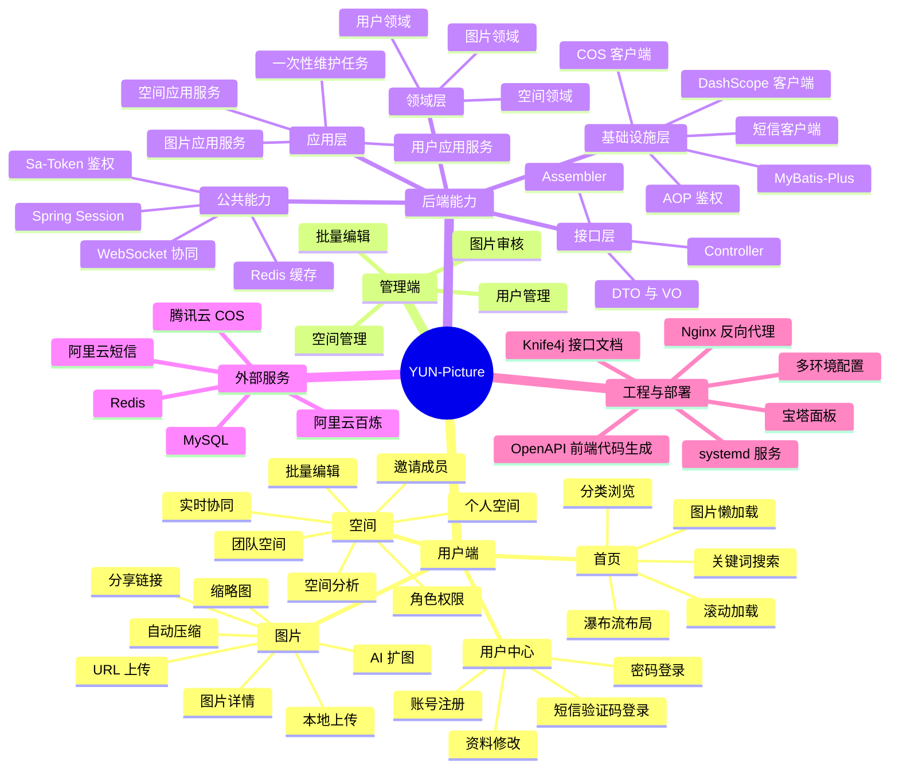
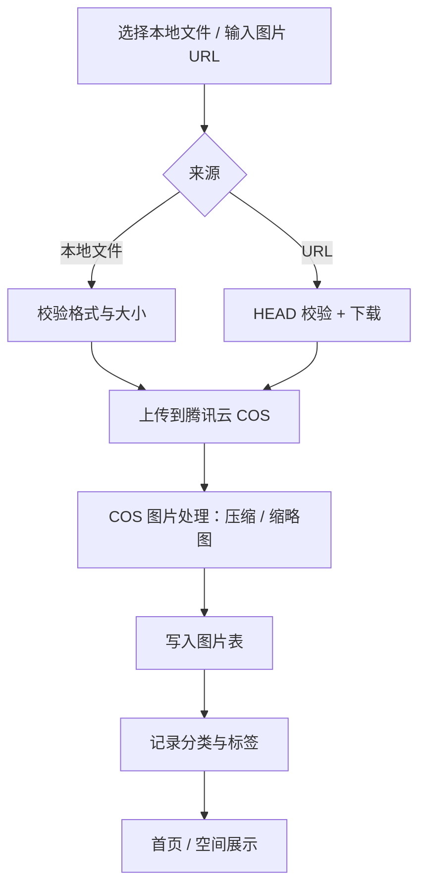
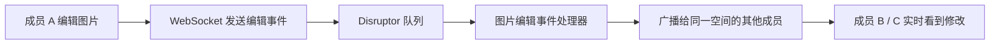

# YUN-Picture 思维导图

> GitHub / VS Code / Typora 等支持 Mermaid 的工具可以直接看到图形；不支持的平台可以看下面的文字版大纲。

## 功能与架构全景



## 图片上传与处理流程



## 团队空间协同编辑流程



## 文字版大纲

```text
YUN-Picture
├── 用户端
│   ├── 首页：瀑布流、滚动加载、图片懒加载、搜索、分类
│   ├── 图片：本地上传、URL 上传、压缩缩略图、详情、分享、AI 扩图
│   ├── 空间：个人/团队空间、邀请成员、角色权限、批量编辑、实时协同、空间分析
│   └── 用户中心：注册、密码登录、短信验证码登录、资料修改
├── 管理端
│   ├── 图片审核
│   ├── 批量编辑
│   ├── 用户管理
│   └── 空间管理
├── 后端能力（DDD）
│   ├── interfaces：Controller、DTO/VO、Assembler
│   ├── application：图片/空间/用户应用服务、维护任务
│   ├── domain：图片、空间、用户领域
│   ├── infrastructure：MyBatis-Plus、COS、DashScope、短信、AOP
│   └── shared：Sa-Token 鉴权、WebSocket 协同、缓存
├── 外部服务
│   ├── MySQL
│   ├── Redis
│   ├── 腾讯云 COS
│   ├── 阿里云百炼（Qwen3-VL、通义万相）
│   └── 阿里云短信
└── 工程与部署
    ├── Knife4j 接口文档
    ├── OpenAPI 前端代码生成
    ├── Nginx 反向代理
    ├── systemd / 宝塔面板
    └── local / prod 多环境配置
```
